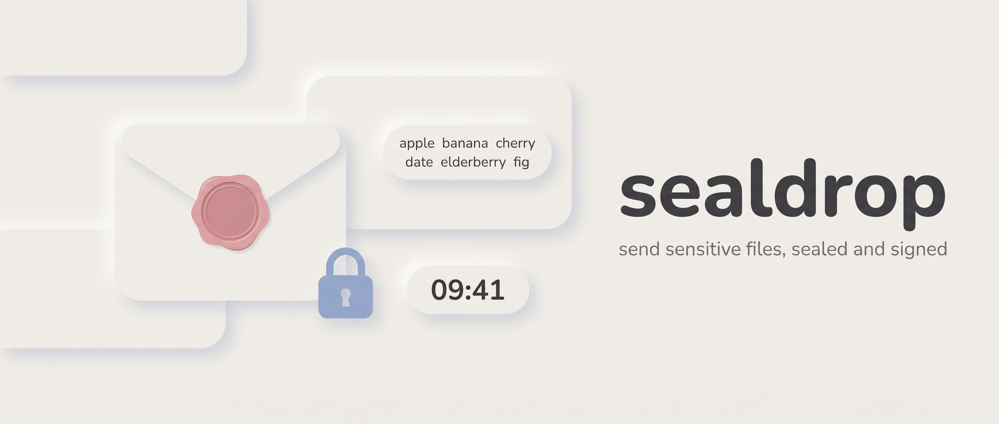
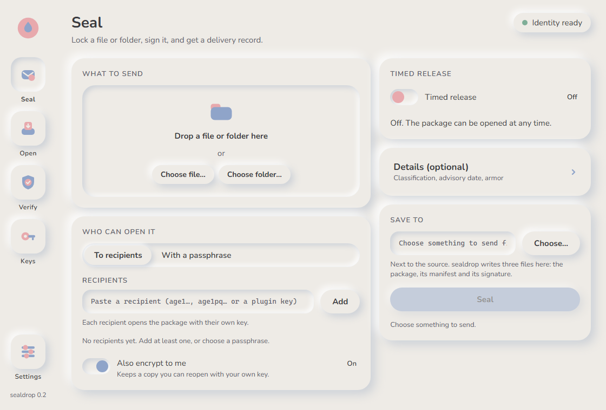
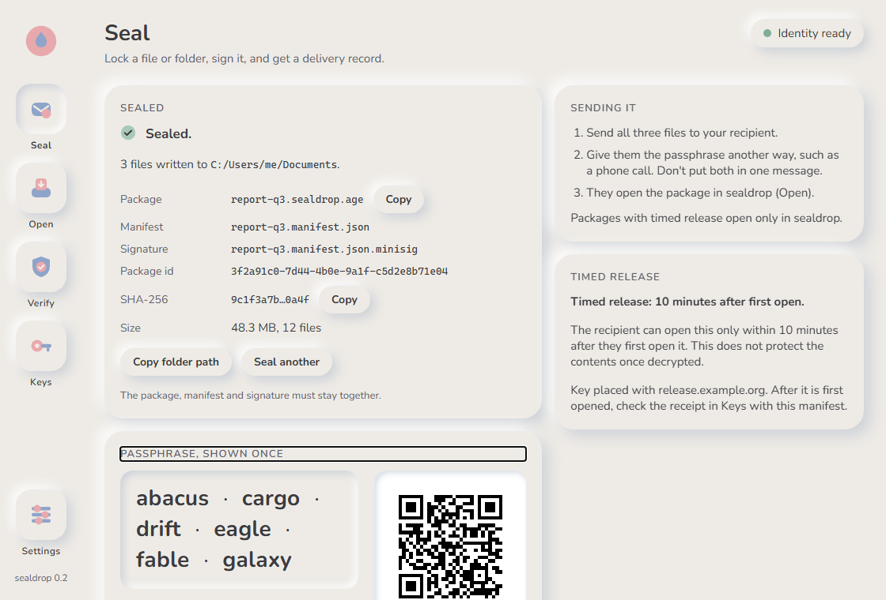
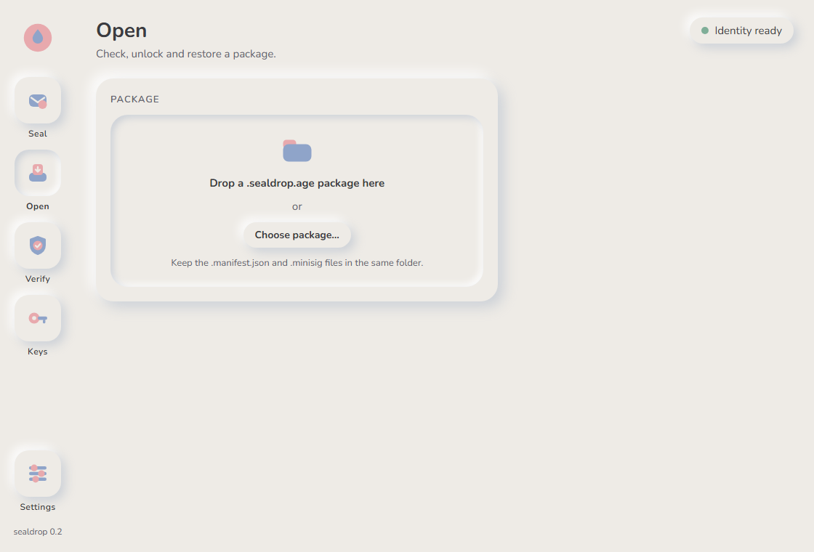
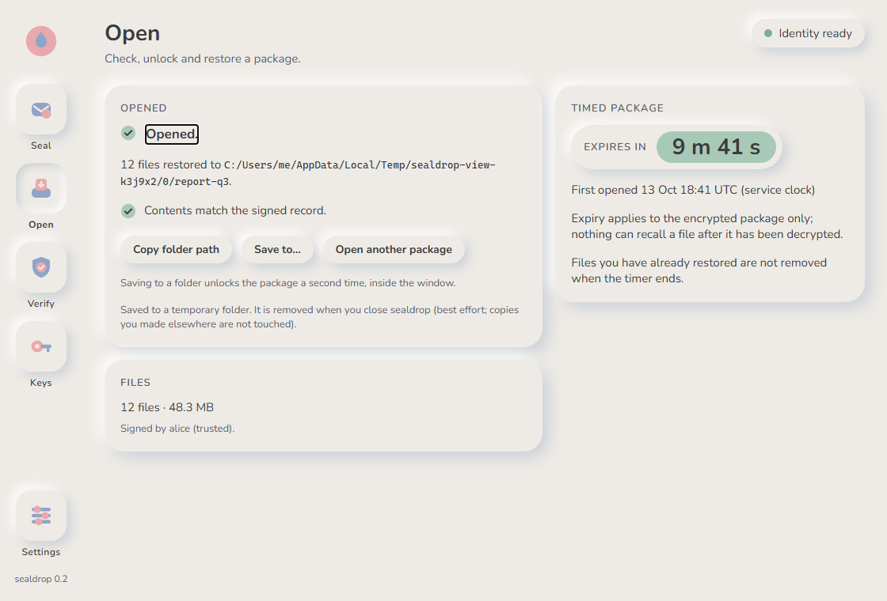
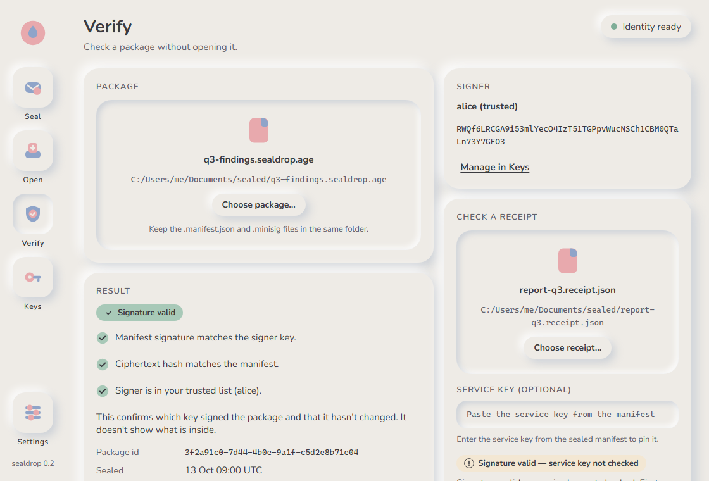
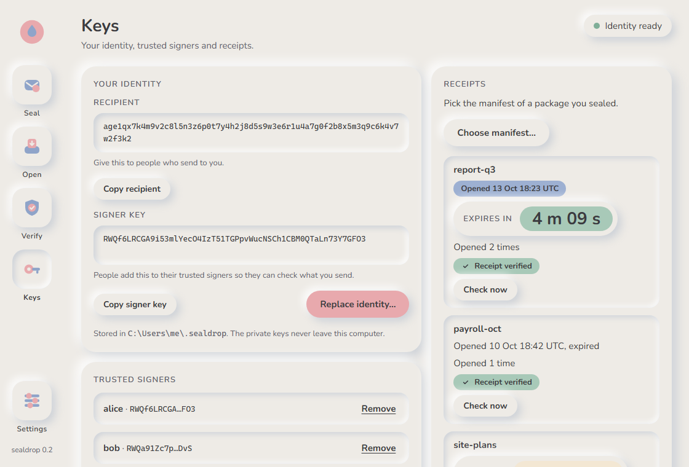
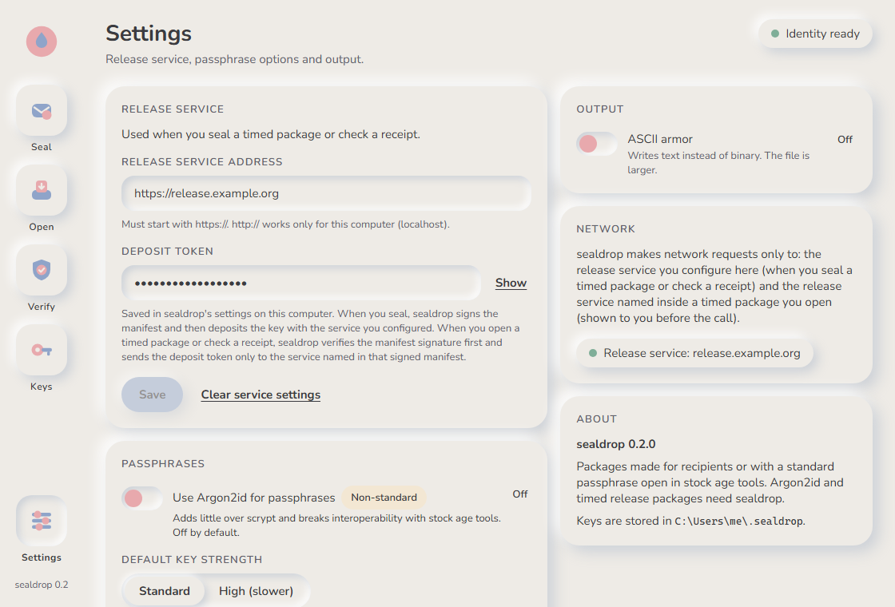

<p align="center">
  
</p>

# sealdrop

Send sensitive files, sealed and signed.

[](https://github.com/Aldiharley/sealdrop/actions/workflows/ci.yml)
[](LICENSE)

sealdrop is an open-source tool for sending a file or folder to someone and being able to prove what you sent. It wraps the [age](https://age-encryption.org) file format, adds a signed delivery record, and can optionally limit how long the recipient can open the package after they first open it. It comes as a command-line tool, a small key-release service, and a desktop app.

Version 0.2. Licence: Apache-2.0.

## Contents

- [What it does](#what-it-does)
- [What it does not do](#what-it-does-not-do)
- [Install](#install)
- [Quick start](#quick-start)
- [Desktop app](#desktop-app)
- [Passphrase mode](#passphrase-mode)
- [Timed release](#timed-release)
- [Hardware keys](#hardware-keys)
- [Argon2id (optional, non-standard)](#argon2id-optional-non-standard)
- [Interop with stock age](#interop-with-stock-age)
- [Security](#security)
- [Command reference](#command-reference)
- [Roadmap](#roadmap)
- [Contributing, licence, credits](#contributing-licence-credits)

## What it does

- **Encrypts a file or folder with standard age.** The package is a tar stream inside an age v1 file, to one or more public-key recipients or to a generated passphrase. Output is binary, or ASCII armor with `--armor`.
- **Signs a delivery record.** Each package comes with a `manifest.json` (hashes, recipients, signer, times) and a [minisign](https://jedisct1.github.io/minisign/) signature over it. The recipient can check both before decrypting anything.
- **Extracts defensively.** `open` refuses symlinks, path tricks, oversized archives and hash mismatches, and writes to a temporary folder that is renamed only on success.
- **Generates passphrases for you.** There is no "choose a password" prompt. You get six EFF words (77.5 bits) or ten BIP-39 words (110 bits).
- **Offers timed release.** A package can be sealed so it opens only within a window (seconds to days) after the recipient first opens it. A key-release service you host enforces this, and you get a signed receipt of the first open.

## What it does not do

- No DRM, screenshot or forwarding prevention. Timed release limits when the *encrypted package* can be opened; it cannot recall decrypted content.
- No new ciphers, cascades, custom formats or deniability.
- No crypto wallet code, blockchain or wallet-core.
- No protection against a compromised sender or recipient device.
- No self-decrypting HTML attachments (they match HTML smuggling and cannot use hardware keys).

These are the non-goals from the [design spec](docs/superpowers/specs/2026-10-13-sealdrop-core-cli-desktop-design.md), with the first one amended for timed release.

## Install

**Windows binaries:** download from the [v0.2.1 release](https://github.com/Aldiharley/sealdrop/releases/tag/v0.2.1): the desktop app as an MSI or NSIS installer, and `sealdrop-0.2.1-windows-x86_64.zip` with `sealdrop.exe` (CLI) and `sealdrop-release.exe` (service). `SHA256SUMS` is alongside. The installers are not code-signed, so Windows SmartScreen warns on first run.

Other platforms: build from source. You need a recent stable Rust toolchain (`rust-toolchain.toml` selects `stable`; the minimum is Rust 1.85).

```sh
git clone https://github.com/Aldiharley/sealdrop
cd sealdrop

# the command-line tool
cargo install --path crates/sealdrop-cli

# the key-release service (only if you want timed release)
cargo install --path crates/sealdrop-release
```

The desktop app needs Node 22.12 or newer and the Tauri CLI:

```sh
cd apps/desktop
npm ci
cargo install tauri-cli --version "^2" --locked   # once
cargo tauri build
```

On Windows this produces an exe, an MSI and an NSIS installer under `target/release/` (see [docs/VALIDATION.md](docs/VALIDATION.md#desktop-build) for the paths and sizes of the 0.2 build). The published installers on the [Releases page](https://github.com/Aldiharley/sealdrop/releases) are these same artefacts, rebuilt from the tagged commit. In the 0.2 validation run the built exe was started and driven; the installers were not installed.

## Quick start

Two people: Alice sends, Bob receives. The keys below are throwaway keys made for this page.

**1. Bob makes an identity and shares his recipient.**

```console
$ sealdrop keygen
age18c6jryvl4ljgm05ql2e6p0rs53qcjcuv5gvvcvlyma9lrmvnmpaqejs97q
RWTa2pIHHf7dLiyVDO3cZDKg1zORsg9HUDahFg5emS4HuXX6XQZ3/KEo
identity written to <key store folder>
share the first line (your recipient) with senders; the second is your signer key
```

The first line is Bob's recipient. It is public. Bob sends it to Alice. Alice runs `sealdrop keygen` too, and sends Bob her signer key (the second line she gets) so Bob can check what she sends.

**2. Alice seals a folder to Bob.**

```console
$ sealdrop seal report-q3 -r age18c6jryvl4ljgm05ql2e6p0rs53qcjcuv5gvvcvlyma9lrmvnmpaqejs97q -o out
packing ...\report-q3
encrypted 4977 bytes
sealed: out\report-q3.sealdrop.age
manifest: out\report-q3.manifest.json
signature: out\report-q3.manifest.json.minisig
package id: 08d9a050-4b7c-4082-a9c5-0a9d8875b263
ciphertext sha256: 74a67008c2ece2ff6bbc971bdba9ca93b7bd2e53cf0f62a67a94109b16af6c6e
```

Alice also gets her own recipient added by default, so she can reopen the package. Pass `--no-self` to turn that off. She sends all three files to Bob.

**3. Bob checks the signature, before decrypting.**

The first time, Bob does not know Alice's signer key, so `verify` stops (exit code 2):

```console
$ sealdrop verify out/report-q3.sealdrop.age
error: verification failed: signer RWTRrN9xUsEDEAu1jg7CEcasioFsM1XHTTmQxDA8IbZ4zx+wPDwgSp27 is not trusted; add it with `sealdrop trust add <name> RWTRrN9xUsEDEAu1jg7CEcasioFsM1XHTTmQxDA8IbZ4zx+wPDwgSp27` or pass --signer
```

Bob compares that key with the one Alice gave him over another channel, then trusts it:

```console
$ sealdrop trust add alice RWTRrN9xUsEDEAu1jg7CEcasioFsM1XHTTmQxDA8IbZ4zx+wPDwgSp27
trusted alice
$ sealdrop verify out/report-q3.sealdrop.age
OK: signature valid, ciphertext hash matches
package id: 08d9a050-4b7c-4082-a9c5-0a9d8875b263
signer: RWTRrN9xUsEDEAu1jg7CEcasioFsM1XHTTmQxDA8IbZ4zx+wPDwgSp27 (alice)
created: 2026-10-13T19:48:52Z
recipient: x25519 bb991ceeaea3318b
recipient: x25519 8175450f0e3ac54b
```

**4. Bob opens it.**

```console
$ sealdrop open out/report-q3.sealdrop.age -o bob-out
verifying manifest
extracting to bob-out
restored: bob-out\report-q3 (2 files, 24 bytes)
verified: signer RWTRrN9xUsEDEAu1jg7CEcasioFsM1XHTTmQxDA8IbZ4zx+wPDwgSp27 (alice)
```

`open` verifies first. `--skip-verify` exists for the case where you only have the `.age` file; decryption still authenticates the data.

## Desktop app

The app (Tauri 2, React 19) has five screens and calls the same Rust core as the CLI. It has no shell, HTTP or file-system plugin exposed to the web view: file access happens in Rust commands on paths you pick in native dialogs. Network access is limited to the release service you configure and the one named inside a timed package you open.

The screenshots below are captures of the interface in mock mode (the front end running in a browser with built-in sample data, 1120 x 760). They are not captures of the packaged app, and sample paths such as `C:\Users\me\.sealdrop` are mock values. See [docs/VALIDATION.md](docs/VALIDATION.md#screenshots).

**Seal.** Pick a file or folder, choose recipients or a generated passphrase, optionally switch on timed release, and get the package, manifest and signature.



*Seal screen, empty form (mock mode, 1120 x 760).*

**Seal, passphrase and timed release.** After a passphrase seal the words appear once with a QR code and the entropy, plus the steps for sending it and the timed-release terms.



*Seal screen after a passphrase seal with a 10-minute window (mock mode, 1120 x 760).*

**Open.** Drop a package. The app shows the delivery record and what the package needs (a key, or a passphrase) before it decrypts anything.



*Open screen, waiting for a package (mock mode, 1120 x 760).*

**Open, timed package.** For a timed package the app shows a countdown computed from the service's expiry time, not from a local timer, and extracts to a temporary folder by default.



*Open screen after opening a timed package (mock mode, 1120 x 760).*

**Verify.** Check the signature and the ciphertext hash without decrypting.



*Verify screen with a valid result (mock mode, 1120 x 760).*

**Keys.** Your recipient and signer key, the signers you trust, and receipts for the timed packages you sent.



*Keys screen (mock mode, 1120 x 760).*

**Settings.** The release service address and deposit token, the Argon2id switch, key strength, ASCII armor, and a plain statement of which network calls the app makes.



*Settings screen (mock mode, 1120 x 760).*

## Passphrase mode

Use a passphrase only when you cannot get a recipient key from the other person. sealdrop does not let you type one. It generates it, shows it once, and never writes it to a file or log.

```console
$ sealdrop seal report-q3 --passphrase -o outp
packing ...\report-q3
encrypted 4790 bytes
passphrase: marine outsource lapel uncut brethren profanity
entropy: 77.5 bits - send it on a different channel from the file
sealed: outp\report-q3.sealdrop.age
...
```

| List | Words | Entropy | Flag |
|---|---|---|---|
| EFF large list (7,776 words) | 6 (the minimum) | 77.5 bits | `--words eff` (default) |
| BIP-39 English (2,048 words) | 10 (the minimum) | 110 bits | `--words bip39` |

- Send the passphrase on a different channel from the file, such as a phone call. Anyone with both can open the package.
- The research behind this choice (entropy matters more than the key-derivation cost) is in [RESEARCH.md](RESEARCH.md).
- The key derivation is age's scrypt at work factor 2^18 by default, 2^20 with `--kdf-profile high`. `open` refuses a package that asks for more than 2^22.
- A passphrase package cannot also have recipient keys. sealdrop refuses the combination (exit code 3).
- In 0.2 the interactive passphrase prompt on `open` shows what you type. Use `--passphrase-stdin` to pipe it in instead. Typing it into a real terminal prompt was not tested; see [VALIDATION.md](docs/VALIDATION.md#known-limitations-observed).

## Timed release

Timed release lets the sender say "this can be opened for 10 minutes after the recipient first opens it". It is off unless you pass `--expire-after` and have a release service.

**How it works.**
1. When you seal, sealdrop makes a random release key, uses it to wrap the package's recipient stanzas, and deposits that key with a `sealdrop-release` service that you run.
2. To open the package, the recipient needs both the release key from the service and their own key or passphrase.
3. The service starts the window at the first successful unlock, using its own clock, hands the key out until the window ends, then deletes it.
4. The service signs a receipt (package hash, first-open time, expiry, unlock count) that you can fetch and check offline.

The recipient's clock and time zone do not matter, because the window is enforced where the key is kept. The service never sees the file key or the contents.

**What the recipient sees:**

> The recipient can open this only within [window] after they first open it. This does not protect the contents once decrypted.

> Expiry applies to the encrypted package only; nothing can recall a file after it has been decrypted.

**What it protects against.** Opening the package after the window. Opening it on a second machine after the window. Copies of the package made before or after the first open: they are useless once the key is gone. A recipient who sets their clock back. A sender who wants to know whether and when the package was first opened.

**What it cannot do.** Anything about the decrypted file. The recipient can save, copy, photograph or forward the contents during the window, and nothing can take them back afterwards.

**Other things to know.**
- Anyone who holds the package files can start the window, but cannot read the contents without the recipient's key or passphrase. Starting it early can cost the real recipient time.
- The service operator can refuse service, which makes the package unopenable. The operator cannot read the file.
- The service must be reachable when the package is opened. There is no offline open.
- **Retention.** If a package is never opened, the service forgets its key after the operator's retention period (default 90 days, set by `--retention-days`). After that the package cannot be opened at all. `seal` prints this when you seal a timed package.
- Timed packages open only in sealdrop. Stock age cannot open them.
- The window is separate from the manifest's `--expires` date, which is advisory and not enforced by any software.
- The service's own time comes from the host clock. Run NTP on that host.

**Example.** A 10-minute window against a local service, from the sender's side and then the recipient's:

```console
$ export SEALDROP_RELEASE_TOKEN=<deposit token from the operator>
$ sealdrop seal report-q3 -r <recipient> --expire-after 10m --release-service http://127.0.0.1:8791 -o outt
...
contacting release service http://127.0.0.1:8791
sealed: outt\report-q3.sealdrop.age
...
Timed release: 10m after first open, enforced by http://127.0.0.1:8791
This does not protect the contents once decrypted.
If the package is never opened, the service forgets the key after its retention period (operator default: 90 days).

$ sealdrop open outt/report-q3.sealdrop.age -o bob-out2        # recipient
This package uses timed release: 10m after first open, enforced by http://127.0.0.1:8791
Opening it starts or continues the window on the service's clock.
verifying manifest
contacting release service http://127.0.0.1:8791
extracting to bob-out2
restored: bob-out2\report-q3 (2 files, 24 bytes)
verified: signer RWTRrN9xUsEDEAu1jg7CEcasioFsM1XHTTmQxDA8IbZ4zx+wPDwgSp27 (alice)
first opened 2026-10-13T19:49:04Z - expires 2026-10-13T19:59:04Z (service clock)
Expiry applies to the encrypted package only; nothing can recall a file after it has been decrypted.

$ sealdrop receipt fetch outt/report-q3.manifest.json          # sender
release: ba3cb5b7-0127-41c5-b9b7-c795729192cd
package sha256: 8a9015d7686bcb4ad86381514fd01d12e637cba3bb311abfc2b5f4b898d16c50
first opened: 2026-10-13T19:49:04Z (service clock), expires 2026-10-13T19:59:04Z
unlock count: 1
service key: RWT/0jEBoZ+uywcIWCELXX0lHZNjoKooOi0ffwGgCXrDWcpWoFGqsleP
saved: outt\report-q3.receipt.json
```

Opening after the window ends exits with code 2 and "this package has expired at the release service and can no longer be opened". That run is recorded in [docs/VALIDATION.md](docs/VALIDATION.md#manual-timed-release-session).

**Receipts are pinned to the service key.** When you seal, the service returns its public key, and sealdrop records it in the signed manifest as `release.service_key`. `receipt fetch` verifies the manifest before it sends your deposit token anywhere, and checks the receipt against that pinned key. `receipt verify --service-key <key>` does the same offline for a saved receipt.

**Self-hosting.** The service is one binary (`sealdrop-release`) with SQLite storage. Setup, the Caddy example, the Docker image, rate limiting, the API and what it stores are in [crates/sealdrop-release/README.md](crates/sealdrop-release/README.md).

**Why not a blockchain?** A public chain cannot hold a secret, and a signed receipt from your own service proves first unlock more cheaply and privately; the reasoning and sources are in [docs/research/2026-10-13-post-unlock-expiry.md](docs/research/2026-10-13-post-unlock-expiry.md).

## Hardware keys

sealdrop can encrypt to hardware-backed age recipients through plugins you have installed. It does not bundle them. The recipient must be one of these plugin names, and the matching `age-plugin-<name>` binary must be on your `PATH`:

| Recipient prefix | Plugin binary |
|---|---|
| `age1yubikey1...` | `age-plugin-yubikey` |
| `age1fido2prf1...` | `age-plugin-fido2prf` |
| `age1se1...` | `age-plugin-se` |
| `age1tpm1...` | `age-plugin-tpm` |

Any other plugin name is refused (exit code 3).

**Recovery rule.** A recipient set made only of hardware keys is refused unless it includes a recovery recipient, or you pass `--allow-unrecoverable`. For ordinary recipient packages your own key is added by default, which counts as the recovery recipient. If you pass `--no-self`, or seal with timed release (which never adds your key), a hardware-only set needs `--allow-unrecoverable`.

To open a package sealed to a hardware key, add its `AGE-PLUGIN-...` identity line to your `identity.txt` in the key store by hand.

This path is covered by unit tests that use synthetic recipients and a missing plugin binary. [docs/VALIDATION.md](docs/VALIDATION.md) records no run against a physical key.

## Argon2id (optional, non-standard)

Argon2id is off by default. Turn it on with `--argon2id` (CLI) or the switch in Settings (desktop).

- It is a sealdrop-only age stanza, `sealdrop-argon2id`. **Files made with it do not open in stock age.** Stock age reports "no matching keys".
- Profiles: `compat` (t=3, 256 MiB, p=4) is the default; `--kdf-profile high` selects `desktop` (t=1, 2 GiB, p=4). Both follow RFC 9106. `open` refuses a package that asks for more than t=10, 2 GiB or p=8.
- Why it is off: with a generated 77.5-bit passphrase, it adds little over scrypt at 2^18, and it costs you interoperability. It exists for people who want a memory-hard function specifically.

The CLI prints `note: Argon2id mode is non-standard; this file will not open in stock age tools` when you use it.

## Interop with stock age

For recipient-mode packages, you do not need sealdrop to get the files back:

```sh
age -d -i identity.txt report-q3.sealdrop.age | tar -x
```

`identity.txt` is the file in the key store (see [Security](#security)). Expect `sealdrop/meta.json` plus `sealdrop/payload/...`.

| Package | Opens with stock age? |
|---|---|
| Recipient mode (age1..., plugins) | Yes. Tested against Go age v1.3.2. |
| Passphrase mode (scrypt) | Yes, by format. Tested with the age crate only: the Go CLI reads a passphrase only from a terminal, so the test cannot drive it. |
| Argon2id passphrase | No, by design. |
| Timed release | No, by design. Stock age fails with "no identity matched any of the recipients". |

Conformance and interop evidence is in [docs/VALIDATION.md](docs/VALIDATION.md#interop-with-stock-age).

## Security

Report a vulnerability as described in [SECURITY.md](SECURITY.md).

**Limits of the threat model.** File encryption cannot revoke access after decryption, stop forwarding of plaintext, or prevent screenshots. Even rights-management systems depend on applications honouring the rights ([Microsoft Purview usage rights](https://learn.microsoft.com/en-us/purview/rights-management-usage-rights)). sealdrop does not protect a compromised sender or recipient machine. There has been no external audit of sealdrop. The research notes also found no public audit of age or rage (that does not prove none exist); see [RESEARCH.md](RESEARCH.md).

**Hardened extraction.** For every entry in the package, `open` enforces these rules ([spec section 7](docs/superpowers/specs/2026-10-13-sealdrop-core-cli-desktop-design.md)):

1. Only regular files and directories. Symlinks, hard links, devices and FIFOs are rejected.
2. Paths must be relative, start with `sealdrop/`, and contain no `..`, `.`, empty parts or NUL. On Windows, also no `\`, `:`, or reserved device names such as `CON`.
3. `sealdrop/meta.json` must be the first entry and is read with a 1 MiB cap.
4. Limits on entry count (default 100,000) and bytes (default 64 GiB).
5. Files are written to a temporary folder, hashed as they are written, and compared with `meta.json`. Any mismatch deletes the folder.
6. On success the folder is renamed. Existing files are never overwritten unless you pass `--overwrite`.

**Key store.** Keys are plain files you can inspect: `identity.txt` (age secret key), `sign.key` and `sign.pub` (minisign), and `trusted/<name>.pub`. They live in `%APPDATA%\sealdrop` on Windows and `~/.config/sealdrop` on Linux and macOS, with mode 0600 on Unix. Set `SEALDROP_HOME` to use another folder. Back up `identity.txt`: without it, packages sealed only to you cannot be opened.

**Known limitations.**
- **19 post-quantum conformance vectors are skipped.** Of the 147 C2SP CCTV age vectors, 128 pass, 19 are skipped and none fail. The skipped ones are the hybrid (`age1pq`) vectors that need a post-quantum identity type, which age 0.12 does not provide. sealdrop can encrypt *to* `age1pq` recipients, but cannot act as one yet.
- **Case-insensitive file systems.** A folder containing both `A.txt` and `a.txt`, sealed on Linux, loses one of them when opened on Windows or macOS.
- Timed release needs the service to be up at open time, and trusts the service host's clock.
- The interactive passphrase prompt shows what you type (see [Passphrase mode](#passphrase-mode)).

Test counts, the CCTV run, the manual timed-release session and the other limitations are in [docs/VALIDATION.md](docs/VALIDATION.md) (149 tests at the time of writing).

## Command reference

`sealdrop`:

| Command | What it does |
|---|---|
| `keygen [--force]` | Create your age identity and minisign signing key. |
| `recipient` | Print your recipient string and signer key. |
| `seal <INPUT>` | Encrypt a file or folder to recipients or a generated passphrase. |
| `verify <PACKAGE>` | Check the signed manifest and ciphertext hash without decrypting. |
| `open <PACKAGE>` | Verify, decrypt and extract safely. |
| `receipt fetch <MANIFEST>` / `receipt verify <RECEIPT>` | Timed release: fetch and verify a receipt (sender) / verify a saved one. |
| `trust add <NAME> <KEY>` / `list` / `remove` | Manage trusted signers. |

Main `seal` flags:

| Flag | Meaning |
|---|---|
| `-r, --recipient <R>` | `age1...`, `age1pq...` or `age1<plugin>1...`. Repeatable. |
| `--passphrase`, `--words eff\|bip39`, `--word-count N` | Generated passphrase. |
| `--kdf-profile default\|high` | scrypt 2^18 or 2^20 (Argon2id `compat` or `desktop` profile with `--argon2id`). |
| `--argon2id` | Non-standard stanza. Not openable in stock age. |
| `--expire-after <90s\|10m\|6h\|3d>`, `--release-service <URL>` | Timed release. The deposit token comes from `SEALDROP_RELEASE_TOKEN` or the settings. |
| `--armor` | ASCII armor. |
| `--classification <text>`, `--expires <YYYY-MM-DD>` | Recorded in the signed manifest. `--expires` is advisory only. |
| `--allow-unrecoverable`, `--no-self` | See [Hardware keys](#hardware-keys). |
| `-o, --out <DIR>` | Where to write the three files. |
| `--qr` | Also print the passphrase as a QR code. |

Main `open` flags: `-o, --out`, `--signer <KEY>`, `--skip-verify`, `--overwrite`, `--passphrase-stdin`.

Exit codes:

| Code | Meaning |
|---|---|
| 0 | Success |
| 1 | Error |
| 2 | Verification failed, or the timed package has expired |
| 3 | Refused by policy |

`sealdrop-release`:

| Command | What it does |
|---|---|
| `keygen --dir <DIR>` | Create the service signing key (`service.key`, `service.pub`). |
| `token new <NAME> --db <DB>` | Create a deposit token for a sender. It is printed once. |
| `serve --listen <ADDR> --db <DB> --dir <DIR>` | Run the service. Defaults to `127.0.0.1:8787`. Also `--retention-days`, `--rate-capacity`, `--rate-refill-per-sec`. |

Run `sealdrop --help`, `sealdrop <command> --help` and `sealdrop-release --help` for the full text.

## Roadmap

Not in 0.2. These are deferred, not promised:

- SLIP-39 k-of-n escrow
- A hosted viewer
- magic-wormhole and one-time-link helpers
- A mail-gateway test matrix
- `cargo-fuzz` in CI
- Reproducible builds
- External review
- Domain and trademark check
- A .NET shell
- A Roughtime cross-check and an RFC 3161 countersignature of receipts
- An `age-plugin-sealdrop` binary, so stock age could handle timed-release files

## Contributing, licence, credits

See [CONTRIBUTING.md](CONTRIBUTING.md) for the dev setup and tests, and [SECURITY.md](SECURITY.md) to report a vulnerability.

sealdrop is licensed under the [Apache License 2.0](LICENSE).

Built with [age](https://age-encryption.org) via [rage](https://github.com/str4d/rage), [minisign](https://jedisct1.github.io/minisign/) and [Tauri](https://tauri.app).
